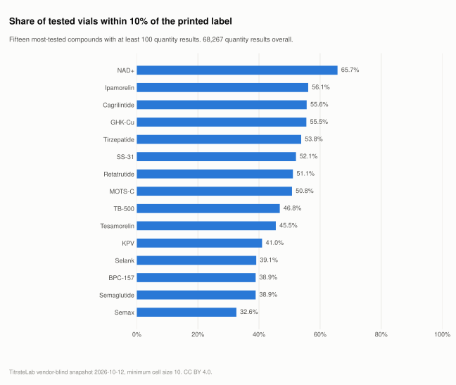

# Peptide lab reports, analyzed

96,805 published lab reports for 68 peptides and blends, aggregated vendor-blind by compound, laboratory and month, and released monthly with the method behind every number. This is release **2026-10-12**, built from records observed through 2026-10-12.

The per-record evidence, with the laboratory, client and batch as printed on each public report, is searchable at [titratelab.com/coa](https://titratelab.com/coa?src=github). This repository holds what can be said about the corpus as a whole.

## Scale

| | |
|---|---|
| Published lab-report entries in the corpus | **116,363** |
| Distinct certificate identifiers | 115,076 (upper bound; key in the manifest) |
| Reports in these tables | 96,805 across 68 compounds and 26 named laboratories |
| Time span | Jul 2022 to Sep 2026, with 79,217 reports in the last 12 full months |
| Measurements inside | 86,594 purity results, 68,267 quantity-versus-label results, 12,516 endotoxin results, 95,221 laboratory verification links |

For comparison, the other open peptide lab datasets measured on 2026-10-12 hold 233, 78 and 500 rows (table [below](#other-open-peptide-lab-datasets)).

## What the data looks like

Each underlying record is one laboratory report for one vial. The fields TitrateLab extracts from it, with illustrative values, and where each one lands in these files:

| Field on the report | Illustrative value | In these files as |
|---|---|---|
| Laboratory | Janoshik | `lab` in `labs.csv` and `lab_month.csv` |
| Compound as printed, then resolved | "Retatrutide 10mg" resolves to Retatrutide | `compound` |
| Test date | 2026-08-14 | `month` |
| Purity (chromatographic area) | 99.7% | `purity_results`, `median_purity_pct`, `zero_identity_results` |
| Printed label versus tested quantity | 10 mg on the label, 9.4 mg found, deviation -6% | `quantity_results`, `quantity_within_10pct_pct`, `quantity_more_than_10pct_under_label` |
| Endotoxin | below detection limit | `endotoxin_results` |
| Verification link printed by the laboratory | present | `verifiable_records` |
| Client, batch, certificate number | printed on the report, never released here | absent by design |

The values above are illustrative, not a real record. The real per-record values, with laboratory, client and batch as printed, are searchable at [titratelab.com/coa](https://titratelab.com/coa?src=github).

One real row from `compounds.csv` in this release:

| compound | test_records | purity_results | median_purity_pct | quantity_results | quantity_within_10pct_pct | endotoxin_results | verifiable_records |
|---|---:|---:|---:|---:|---:|---:|---:|
| Retatrutide | 19,632 | 18,008 | 99.85 | 16,225 | 51.1% | 4,256 | 19,373 |

Read it as: 19,632 published reports for Retatrutide. 18,008 of them carry a purity figure, with a median of 99.85%. 16,225 state a tested quantity against the label, and 51.1% of those fall within 10% of it. 4,256 include an endotoxin result. 19,373 carry the laboratory's verification link.

## What the data shows

1. **Purity is rarely the problem. Quantity is.** Across the 35 compounds with at least 100 quantity results, the share of vials within 10% of the printed label runs from 22.2% (LL-37) to 90.1% (Glutathione). Overall, 49.9% of 68,267 quantity results are within 10% of label and 4,473 are more than 10% under it. [Analysis](analysis/01-quantity-vs-label.md)
2. **Endotoxin testing is uncommon.** 12.9% of included reports carry any endotoxin result. A report without one says nothing about endotoxin either way. [Analysis](analysis/02-endotoxin-testing-rate.md)
3. **A small share of vials contain none of the labelled compound.** 0.77% of purity results are reported at zero, meaning the laboratory did not identify the target compound. The rest cluster near the top: the median purity for most compounds is above 99%. [Analysis](analysis/03-purity-and-zero-identity.md)

<picture>
  <source media="(prefers-color-scheme: dark)" srcset="charts/quantity-within-label-dark.svg">
  
</picture>

## The corpus in numbers

| Measure | Value | Note |
|---|---:|---|
| Published lab-report entries | 116,363 | Every published entry in the corpus, before any exclusion |
| Distinct certificate identifiers | 115,076 | Upper bound; key and caveat in [methodology/deduplication.md](methodology/deduplication.md) |
| Included in these tables | 96,805 | Resolved to a recognized peptide name and above the cell floor |
| Excluded as non-peptide or unresolved | 17,774 | Water, hormones, vitamins, unreadable names |
| Compounds and blends | 68 | 54 more fell below the floor of 10 records |
| Named laboratories | 26 | 19 below the floor are reported together as "Other labs" |
| Months covered | 44 | Jul 2022 to Sep 2026, full months only |
| Reports with a verification URL | 98.4% | 1,584 carry none |

Sources by category: community and buyer submissions 2,917; independent lab panel reports 12,100; independent lab public portals 77,609; third-party aggregators and vendor libraries 4,303. Definitions in [methodology/collection.md](methodology/collection.md).

## Analyses

| # | Question | Verdict |
|---|---|---|
| 1 | [How often is the tested quantity within 10% of the label?](analysis/01-quantity-vs-label.md) | 49.9% overall; 22.2% to 90.1% by compound |
| 2 | [How often is endotoxin tested at all?](analysis/02-endotoxin-testing-rate.md) | 12.9% of reports carry a result |
| 3 | [What do purity figures look like, and how often is the compound absent?](analysis/03-purity-and-zero-identity.md) | Zero identity in 0.77% of purity results |
| 4 | [Can a reader verify a report with the laboratory?](analysis/04-verifiability.md) | 98.4% carry a verification URL |
| 5 | [How fast is public testing growing?](analysis/05-testing-volume-by-month.md) | 79,217 reports in the last 12 full months, +605.5% on the 12 before; collection coverage grew over the period, so this overstates market growth |
| 6 | [Which laboratories issue the reports?](analysis/06-lab-mix.md) | Freedom Diagnostics issued 67.8% of included reports |

## Questions this data answers

- **Are peptide vials underdosed?** Often enough to matter. 49.9% of 68,267 tested vials are within 10% of the printed label and 4,473 are more than 10% under it. [Analysis 1](analysis/01-quantity-vs-label.md)
- **Is purity the problem?** Rarely. The median purity is above 99% for most compounds. The informative tail is the 0.77% of purity results at zero, where the laboratory did not find the labelled compound. [Analysis 3](analysis/03-purity-and-zero-identity.md)
- **How often is endotoxin tested?** 12.9% of reports carry any endotoxin result. The rest say nothing about endotoxin either way. [Analysis 2](analysis/02-endotoxin-testing-rate.md)
- **Can a report be checked with the laboratory?** 98.4% carry a verification URL. [Analysis 4](analysis/04-verifiability.md)
- **Which laboratories issue the public reports?** Freedom Diagnostics (67.8%), Janoshik (13.4%) and Finnrick panel labs (anonymized) (12.5%) lead this corpus. That reflects what is public and collected, not market share. [Analysis 6](analysis/06-lab-mix.md)
- **Is this a market sample?** No. Vials are tested and published by choice, so every page states what its figure cannot establish.
- **Where is one specific report?** Not here. Per-record search with laboratory, client and batch as printed is at [titratelab.com/coa](https://titratelab.com/coa?src=github).

## For researchers

- **Load it.** Every table is a plain UTF-8 CSV with a header row.

  ```python
  import pandas as pd
  url = "https://raw.githubusercontent.com/TitrateLab/peptide-coa-analysis/main/data/latest/"
  compounds = pd.read_csv(url + "compounds.csv")
  by_month  = pd.read_csv(url + "compound_month.csv")
  ```

  ```r
  url <- "https://raw.githubusercontent.com/TitrateLab/peptide-coa-analysis/main/data/latest/"
  compounds <- read.csv(paste0(url, "compounds.csv"))
  ```

- **Unit.** Rows are aggregates of published lab-report entries, never single reports. Entries and distinct certificate identifiers are both reported in the manifest with the key; see [methodology/deduplication.md](methodology/deduplication.md).
- **Denominators.** Each share is computed over records that carry the field. `quantity_within_10pct_pct` is over `quantity_results`, not over `test_records`. Means and medians exclude zero-purity results, which are counted in `zero_identity_results`.
- **Suppression.** Every cell holds at least 10 records. Omitted cells and folded laboratories are counted in the manifest, so totals can be reconciled.
- **Sampling.** None. Treat the figures as describing the public evidence base, not the market.
- **Fitness for use, biases, maintenance.** [DATASHEET.md](DATASHEET.md), structured after Gebru et al. (2021).
- **Cite.** `CITATION.cff` or the "Cite this repository" button. Each release is a fixed version; cite the version you used.

## Reproduce measurement coverage

Open [Peptide COA coverage: what is missing?](notebooks/peptide-coa-coverage-missingness.ipynb) to reproduce field availability, reconcile missing counts against the manifest, and explore a compound with its own denominator. The notebook uses the fixed **2026-10-12** release and verifies its CSV checksum. It distinguishes positive-purity results from zero-purity/unidentified-target entries and exports a chart and coverage table.

From a clone of this repository:

```bash
python -m pip install -r requirements.txt pandas jupyterlab
python -m jupyterlab notebooks/peptide-coa-coverage-missingness.ipynb
```

Choose **Run All**. The notebook finds `data/releases/2026-10-12/` from the repository root or `notebooks/`; for a separate extracted archive, set `TITRATELAB_DATA_DIR` to its directory. Dependencies require installation once; the analysis then runs offline. Missing measurements are not failed tests, and coverage does not estimate market prevalence.

## Files

| Path | Contents |
|---|---|
| `data/latest/manifest.json` | Version, coverage, missing-data counts, laboratory rules, file hashes |
| `data/latest/compounds.csv` | One row per compound (68 rows) |
| `data/latest/compound_month.csv` | Compound by test month |
| `data/latest/labs.csv` | One row per laboratory label, with the TitrateLab profile link where one exists |
| `data/latest/lab_month.csv` | Laboratory by test month |
| `data/latest/months.csv` | All included reports by test month |
| `data/releases/<version>/` | Every release, never rewritten |
| `schema/data-dictionary.md` | Every column and manifest key |
| `methodology/` | Collection, deduplication, name resolution, quality, privacy boundary |
| `notebooks/` | Reproduce every chart from `data/latest` |

Every cell in every table holds at least 10 records. No file names a vendor, client, batch or certificate. The full rule set is in [methodology/privacy-boundary.md](methodology/privacy-boundary.md).

## Get the full data

| Need | Where | State |
|---|---|---|
| One report, with laboratory, client and batch as printed | [titratelab.com/coa](https://titratelab.com/coa?src=github) | Free, per-record search |
| Laboratory profiles and what each publishes | [titratelab.com/labs](https://titratelab.com/labs?src=github) | Free |
| Per-record, vendor-identified queries | [Data API](https://titratelab.com/developer?src=github) | Controlled beta; every request is reviewed by hand |
| A cut this repository does not publish | [Open a data request](../../issues/new?template=data-request.yml) | Public issue, answered here |
| Raw corpus under contract | [Contact](https://titratelab.com/contact?src=github) | Operator-produced, no self-serve |

## Method in brief

- Source: TitrateLab's read-only projection of published lab reports, rebuilt every ten minutes from the live corpus. [Collection](methodology/collection.md)
- Names: printed compound names resolve to a canonical name; unresolved rows are excluded and counted. Laboratory names follow an alias rule, a panel-group rule and a floor fold. [Canonicalization](methodology/canonicalization.md)
- Counting: entries and certificate identifiers are both reported, with the key. [Deduplication](methodology/deduplication.md)
- Quality: extraction is imperfect; completeness is published per field rather than assumed. [Quality holds](methodology/quality-holds.md)
- Every number in this README and in `analysis/` is rendered from the release files by `scripts/build_release.py`. Nothing is typed by hand.

## Limitations

- The corpus is not a random sample of the market. Vials are tested because someone chose to test them and published because someone chose to publish them.
- Coverage differs by laboratory. One laboratory's public portal is collected nearly in full; others are collected partially. The laboratory mix describes this corpus, not the testing market.
- 28,538 included reports have no quantity-versus-label figure and 9,540 have no measured purity. Shares are always computed over the records that have the field.
- Quantity deviation is measured against the printed label. A separate batch claim is not substituted.
- A test record describes one vial on one date. It does not establish the safety, quality or suitability of a product, a batch or a vendor, and nothing here is medical advice.

## Other open peptide lab datasets

Measured 2026-10-12 from each project's public files, listed so a reader can pick the right source. The figures for the other projects are as of that date; this repository's row updates with every release.

| Dataset | What it holds | Size | Last updated |
|---|---|---|---|
| [vialaudit/peptide-coa-data](https://github.com/vialaudit/peptide-coa-data) | COA metadata from public laboratory listings plus a seven-vendor price index | 233 COA rows, 81 price rows | 2026-05-11 |
| [peptigrity/peptide-purity-index](https://github.com/peptigrity/peptide-purity-index) | A recency-weighted purity index, one row per compound | 78 rows | 2026-09-29 |
| [ThePeptideWatch/peptide-watch-dataset](https://github.com/ThePeptideWatch/peptide-watch-dataset) | A vendor-level audit of UK sellers' certificates | 500 vendor records | 2026-10-11 |
| This repository | Aggregates by compound, laboratory and month over 96,805 included reports | 68 compounds, 26 laboratories, 44 months | 2026-10-12 |

The vendor-level audit answers a question this repository deliberately does not; see [methodology/privacy-boundary.md](methodology/privacy-boundary.md).

## Freshness

Releases are cut monthly. `data/latest/` equals the newest directory under `data/releases/`, and `manifest.json` carries the projection identifier and the observed-through timestamp for this release. A release more than 45 days old is overdue; open an issue if you find one.

## License and citation

Data and analysis: [CC BY 4.0](LICENSE). Code: [MIT](LICENSE-CODE). Use the fixed release you analyzed, rather than citing `data/latest/`, which changes with future releases.

Suggested dataset citation:

> TitrateLab. (2026). *TitrateLab peptide COA analysis: vendor-blind aggregates of 96,805 published lab reports (release 2026-10-12)* (Version 2026-10-12) [Data set]. Zenodo. https://doi.org/10.5281/zenodo.23551719

The [archived dataset](https://doi.org/10.5281/zenodo.23551719) preserves this release. The DOI is also in [CITATION.cff](CITATION.cff), used by GitHub's "Cite this repository" button.

When reusing a table, chart or calculation, name TitrateLab, identify release 2026-10-12, link the source and [CC BY 4.0 license](https://creativecommons.org/licenses/by/4.0/), and state what you changed. Include the metric's denominator and exclusions alongside the result. Published report entries are not unique batches or a representative market sample; an absent measurement is not a zero or a passing result.

For example, a chart caption can say: "Source: TitrateLab, peptide COA analysis, release 2026-10-12, DOI: 10.5281/zenodo.23551719 (CC BY 4.0). Endotoxin-result coverage counts reports carrying any endotoxin result, including below-detection outcomes, out of included report entries. It does not measure safety or market-wide testing prevalence. Chart adapted by [your name]."

See the [dataset catalog and release context](https://titratelab.com/data), [measurement methodology](https://titratelab.com/methodology), and [column definitions](schema/data-dictionary.md) before interpreting a result.

## Related

- [TitrateLab data catalog](https://titratelab.com/data?src=github): the four evidence layers, kept separate on purpose.
- [How to read a certificate of analysis](https://titratelab.com/research?src=github): the research library.
