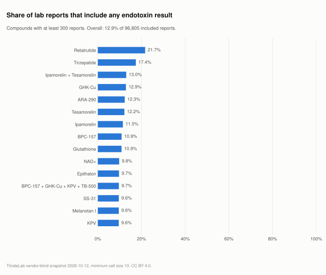

# How often is endotoxin tested at all?

**Verdict:** 12.9% of 96,805 included reports carry any endotoxin result. Among the 36 compounds with at least 300 reports, the rate runs from 1.4% (HGH) to 21.7% (Retatrutide). The remaining 84,289 reports say nothing about endotoxin either way: the test was not ordered, so the report cannot pass or fail it.

Release 2026-10-12, records observed through 2026-10-12.

<picture>
  <source media="(prefers-color-scheme: dark)" srcset="../charts/endotoxin-testing-rate-dark.svg">
  
</picture>

## By compound

Compounds with at least 300 reports, ranked by the share of reports that include an endotoxin result.

| Compound | Reports | With an endotoxin result | Share |
|---|---:|---:|---:|
| Retatrutide | 19,632 | 4,256 | 21.7% |
| Tirzepatide | 12,518 | 2,179 | 17.4% |
| Ipamorelin + Tesamorelin | 461 | 60 | 13.0% |
| GHK-Cu | 5,007 | 645 | 12.9% |
| ARA-290 | 576 | 71 | 12.3% |
| Tesamorelin | 4,864 | 592 | 12.2% |
| Ipamorelin | 2,090 | 240 | 11.5% |
| BPC-157 | 4,772 | 520 | 10.9% |
| Glutathione | 1,022 | 111 | 10.9% |
| NAD+ | 3,587 | 351 | 9.8% |
| Epithalon | 1,442 | 140 | 9.7% |
| BPC-157 + GHK-Cu + KPV + TB-500 | 2,259 | 218 | 9.7% |
| SS-31 | 1,996 | 192 | 9.6% |
| Melanotan I | 593 | 57 | 9.6% |
| KPV | 1,939 | 186 | 9.6% |
| Selank | 1,569 | 148 | 9.4% |
| CJC-1295 w/ DAC | 320 | 30 | 9.4% |
| Melanotan II | 1,409 | 127 | 9.0% |
| TB-500 | 2,444 | 209 | 8.6% |
| PT-141 | 1,383 | 115 | 8.3% |
| Semax | 1,706 | 139 | 8.1% |
| MOTS-C | 4,371 | 355 | 8.1% |
| Semaglutide | 2,393 | 193 | 8.1% |
| DSIP | 1,035 | 83 | 8.0% |
| Thymosin Alpha-1 | 915 | 72 | 7.9% |
| Kisspeptin | 661 | 52 | 7.9% |
| AOD-9604 | 981 | 77 | 7.8% |
| Sermorelin | 1,038 | 81 | 7.8% |
| Cagrilintide | 1,450 | 108 | 7.4% |
| 5-Amino-1MQ | 1,230 | 91 | 7.4% |
| CJC-1295 | 1,091 | 69 | 6.3% |
| CJC-1295 + Ipamorelin | 1,954 | 121 | 6.2% |
| BPC-157 + TB-500 | 2,641 | 163 | 6.2% |
| SNAP-8 | 304 | 17 | 5.6% |
| BPC-157 + GHK-Cu + TB-500 | 1,516 | 58 | 3.8% |
| HGH | 424 | 6 | 1.4% |

## What the figure means

Endotoxin testing is a separate assay from purity and quantity, ordered separately and priced separately. A certificate that reports purity and quantity but no endotoxin figure is a complete certificate for what was ordered. It is not evidence about endotoxin.

The share counted here includes every kind of endotoxin outcome: a numeric value, a "below detection limit" line, or a pass. It does not say what the outcome was, only that the question was asked.

## Method

- Population: all included records (96,805).
- A record counts as carrying an endotoxin result when the extracted endotoxin status field is non-empty.
- Source columns: `endotoxin_results` and `test_records` in `data/latest/compounds.csv`; the same columns by laboratory in `labs.csv` and by month in `months.csv`.

## Limitations

- The share reflects what was ordered and what was printed, not the safety of any vial.
- Extraction can miss an endotoxin line printed in an unusual layout. Completeness counts are in the manifest under `missing_data`.
- Laboratories differ in whether they offer the assay at all, so the laboratory mix in this corpus shapes the overall rate.

## See the records

Reports that include endotoxin results can be found through the per-record search at [titratelab.com/coa](https://titratelab.com/coa?src=github).
