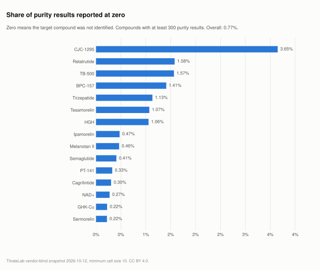

# What do purity figures look like, and how often is the compound absent?

**Verdict:** Purity figures cluster at the top. Of the 15 most-tested compounds, 15 have a median purity of 99% or higher. The informative tail is at zero: 671 of 87,265 purity results (0.77%) report zero, meaning the laboratory did not identify the labelled compound in the vial at all. Among compounds with at least 300 purity results the zero rate runs from 0.00% (Ipamorelin + Tesamorelin) to 3.65% (CJC-1295).

Release 2026-10-12, records observed through 2026-10-12.

<picture>
  <source media="(prefers-color-scheme: dark)" srcset="../charts/zero-identity-share-dark.svg">
  
</picture>

## Purity by compound

The fifteen most-tested compounds. Mean and median are computed over results above zero; zero results are counted separately.

| Compound | Purity results | Median purity | Mean purity | Zero identity | Zero share |
|---|---:|---:|---:|---:|---:|
| Retatrutide | 18,008 | 99.85% | 99.66% | 289 | 1.58% |
| Tirzepatide | 11,606 | 99.85% | 99.68% | 133 | 1.13% |
| GHK-Cu | 4,476 | 99.82% | 99.69% | 10 | 0.22% |
| Tesamorelin | 4,435 | 99.63% | 99.21% | 48 | 1.07% |
| BPC-157 | 4,053 | 99.43% | 99.14% | 58 | 1.41% |
| MOTS-C | 3,985 | 99.53% | 99.47% | 8 | 0.20% |
| NAD+ | 2,924 | 99.90% | 99.73% | 8 | 0.27% |
| BPC-157 + TB-500 | 2,222 | 99.34% | 99.26% | 0 | 0.00% |
| TB-500 | 2,075 | 99.38% | 98.97% | 33 | 1.57% |
| Semaglutide | 2,190 | 99.81% | 99.66% | 9 | 0.41% |
| BPC-157 + GHK-Cu + KPV + TB-500 | 2,041 | 99.75% | 99.70% | 0 | 0.00% |
| Ipamorelin | 1,887 | 99.80% | 99.50% | 9 | 0.47% |
| SS-31 | 1,819 | 99.83% | 99.78% | 3 | 0.16% |
| CJC-1295 + Ipamorelin | 1,768 | 99.84% | 99.76% | 0 | 0.00% |
| KPV | 1,711 | 99.67% | 99.56% | 0 | 0.00% |

## What the figures mean

Purity on a peptide certificate is normally the chromatographic area share of the main peak, in percent. It says how much of what is in the vial is the target compound. It does not say how much is in the vial; that is the quantity figure in [analysis 1](01-quantity-vs-label.md). A vial can be 99.5% pure and 40% under label.

A purity of zero is a different kind of result. The laboratory looked for the labelled compound and did not find it. The vial may contain a different compound, a degraded one, or nothing. Those results are kept out of the mean and median so that they do not drag an average down into a number that describes no real vial, and they are counted on their own.

## Method

- Population: included records with a purity figure (86,594 above zero plus 671 at zero). 9,540 included records have no purity figure and are absent from this page.
- Zero share is computed over results above zero plus results at zero.
- Source columns: `purity_results`, `zero_identity_results`, `mean_purity_pct`, `median_purity_pct` in `data/latest/compounds.csv`.

## Limitations

- Purity figures from different laboratories, methods and dates are pooled. The median is robust to a few outliers but still mixes methods.
- A reported purity near 100% with a low quantity, or a zero, is where the useful information sits. The average purity of the corpus is not a useful number on its own and is not presented as one.
- OCR can misread a digit. Consistency checks catch most such errors; some remain. See [methodology/quality-holds.md](../methodology/quality-holds.md).

## See the records

Search individual reports at [titratelab.com/coa](https://titratelab.com/coa?src=github).
