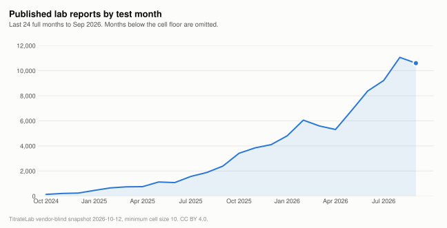
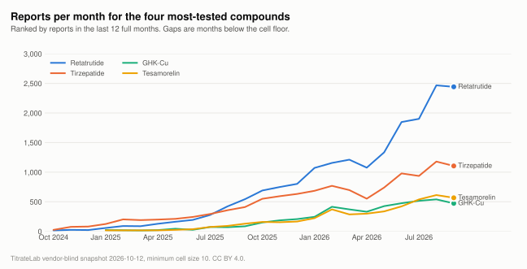

# How fast is public testing growing?

**Verdict:** 79,217 included reports carry a test date in the 12 full months from Oct 2025 to Sep 2026, against 11,229 in the 12 months before, a change of +605.5%. The four most-tested compounds over that period are Retatrutide, Tirzepatide, GHK-Cu, Tesamorelin.

Release 2026-10-12, records observed through 2026-10-12. The partial month Oct 2026 is excluded from every figure on this page.

<picture>
  <source media="(prefers-color-scheme: dark)" srcset="../charts/testing-volume-dark.svg">
  
</picture>

<picture>
  <source media="(prefers-color-scheme: dark)" srcset="../charts/compound-volume-dark.svg">
  
</picture>

## By month

| Month | Reports | With purity | Median purity | With quantity | Within 10% of label | With endotoxin |
|---|---:|---:|---:|---:|---:|---:|
| Oct 2024 | 136 | 109 | 99.55% | 65 | 53.8% | 4 |
| Nov 2024 | 210 | 180 | 99.64% | 121 | 57.9% | 1 |
| Dec 2024 | 240 | 216 | 99.66% | 132 | 61.4% | 10 |
| Jan 2025 | 453 | 404 | 99.71% | 311 | 48.2% | 9 |
| Feb 2025 | 654 | 606 | 99.70% | 502 | 42.8% | 46 |
| Mar 2025 | 739 | 657 | 99.71% | 517 | 47.6% | 36 |
| Apr 2025 | 752 | 657 | 99.53% | 510 | 57.6% | 28 |
| May 2025 | 1,124 | 1,014 | 99.62% | 860 | 45.9% | 64 |
| Jun 2025 | 1,077 | 972 | 99.64% | 757 | 55.1% | 124 |
| Jul 2025 | 1,565 | 1,382 | 99.66% | 1,038 | 51.3% | 253 |
| Aug 2025 | 1,884 | 1,642 | 99.74% | 1,283 | 53.1% | 347 |
| Sep 2025 | 2,395 | 2,123 | 99.77% | 1,655 | 55.5% | 357 |
| Oct 2025 | 3,414 | 2,958 | 99.72% | 2,333 | 55.6% | 710 |
| Nov 2025 | 3,846 | 3,344 | 99.72% | 2,624 | 54.9% | 641 |
| Dec 2025 | 4,105 | 3,607 | 99.71% | 2,803 | 57.5% | 632 |
| Jan 2026 | 4,811 | 4,282 | 99.70% | 3,299 | 49.0% | 903 |
| Feb 2026 | 6,056 | 5,450 | 99.73% | 4,134 | 44.8% | 1,047 |
| Mar 2026 | 5,591 | 5,082 | 99.76% | 4,125 | 47.1% | 930 |
| Apr 2026 | 5,310 | 4,898 | 99.75% | 3,843 | 49.4% | 539 |
| May 2026 | 6,822 | 6,251 | 99.79% | 4,976 | 49.0% | 797 |
| Jun 2026 | 8,377 | 7,914 | 99.78% | 6,267 | 51.0% | 556 |
| Jul 2026 | 9,223 | 8,737 | 99.77% | 7,037 | 47.2% | 331 |
| Aug 2026 | 11,061 | 10,512 | 99.80% | 8,583 | 49.7% | 1,092 |
| Sep 2026 | 10,601 | 10,313 | 99.80% | 8,367 | 48.2% | 2,556 |

## What the figure means

The month is the test date printed on the report, not the date TitrateLab collected it. A rise in a month can mean more testing, more publishing of tests, or more collection of published tests; the corpus cannot separate the three. The most recent months also keep growing after a release as laboratories publish and collectors catch up, so the newest full month is understated relative to how it will look in a later release.

## Method

- Population: included records with a valid test date (93,537; 3,268 have none).
- Months below the cell floor of 10 records are omitted, which is why the series starts at Jul 2022.
- Growth compares the sum of the last 12 full months with the 12 before them.
- Source files: `data/latest/months.csv` and `data/latest/compound_month.csv`.

## Limitations

- Collection coverage changed over time as sources were added. The early part of the series reflects what had been collected, not what had been tested.
- A few reports carry implausible dates from misread digits; they fall into months below the floor and are omitted.

## See the records

Search by compound and date at [titratelab.com/coa](https://titratelab.com/coa?src=github).
