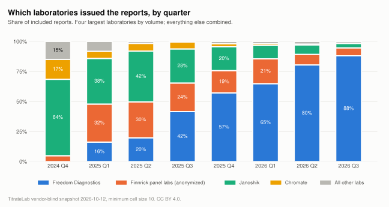

# Which laboratories issue the reports?

**Verdict:** Freedom Diagnostics issued 67.8% of the 96,805 included reports, Janoshik 13.4% and Finnrick panel labs (anonymized) 12.5%. That mix describes this corpus, not the testing market: one laboratory's public portal is collected nearly in full, others partially, and some laboratories publish nothing. Read the laboratory table as "what is public and collected", never as market share.

Release 2026-10-12, records observed through 2026-10-12.

<picture>
  <source media="(prefers-color-scheme: dark)" srcset="../charts/lab-mix-dark.svg">
  
</picture>

## By laboratory

Every laboratory label above the cell floor, in order of volume. Rules for aliases, the anonymized panel group and the floor fold are in [methodology/canonicalization.md](../methodology/canonicalization.md).

| Laboratory | Reports | Share | Median purity | With endotoxin | With verification URL | First test | Latest test |
|---|---:|---:|---:|---:|---:|---|---|
| [Freedom Diagnostics](https://titratelab.com/labs/freedom-diagnostics?src=github) | 65,634 | 67.8% | 99.77% | 9.6% | 100.0% | 2002-10-03 | 2026-10-10 |
| [Janoshik](https://titratelab.com/labs/janoshik?src=github) | 13,020 | 13.4% | 99.66% | 2.8% | 94.1% | 2019-11-10 | 2026-09-30 |
| [Finnrick panel labs (anonymized)](https://titratelab.com/labs/finnrick?src=github) | 12,116 | 12.5% | 99.80% | 44.3% | 99.9% | 2024-12-17 | 2026-09-25 |
| [Chromate](https://titratelab.com/labs/chromate?src=github) | 1,594 | 1.6% | 99.50% | 10.8% | 99.5% | 2024-03-05 | 2026-08-22 |
| [ILS Laboratories](https://titratelab.com/labs/ils-laboratories?src=github) | 742 | 0.8% | 99.68% | 12.9% | 88.1% | 2026-04-04 | 2026-09-24 |
| [Kovera Labs](https://titratelab.com/labs/kovera-labs?src=github) | 703 | 0.7% | 99.77% | 7.5% | 90.5% | 2026-02-16 | 2026-08-08 |
| [Vanguard Laboratory](https://titratelab.com/labs/vanguard-laboratory?src=github) | 637 | 0.7% | 99.65% | 4.7% | 71.0% | 2024-10-28 | 2026-09-02 |
| Lab not recorded | 407 | 0.4% | 99.66% | 1.5% | 84.8% | 2023-04-19 | 2026-09-25 |
| [TrustPointe Analytics](https://titratelab.com/labs/trustpointe-analytics?src=github) | 360 | 0.4% | 99.79% | 0.0% | 88.9% | 2024-10-26 | 2026-10-01 |
| [Peptide Test](https://titratelab.com/labs/peptide-test?src=github) | 340 | 0.4% | 99.70% | 0.6% | 62.4% | 2023-03-04 | 2026-04-06 |
| [Horizon Analytical](https://titratelab.com/labs/horizon-analytical?src=github) | 202 | 0.2% | 99.65% | 1.5% | 48.5% | 2026-03-27 | 2026-09-09 |
| [BioRegen](https://titratelab.com/labs/bioregen?src=github) | 183 | 0.2% | 99.63% | 1.1% | 100.0% | 2020-11-19 | 2026-09-08 |
| [Accumark Labs](https://titratelab.com/labs/accumark-labs?src=github) | 152 | 0.2% | 99.84% | 0.0% | 98.7% | 2026-05-27 | 2026-09-08 |
| [Testides](https://titratelab.com/labs/testides?src=github) | 135 | 0.1% | 99.65% | 37.0% | 93.3% | 2025-09-11 | 2026-09-11 |
| [Krause Analytical](https://titratelab.com/labs/krause-analytical?src=github) | 89 | 0.1% | 99.61% | 2.2% | 75.3% | 2025-07-17 | 2026-09-17 |
| [Ethos Analytics](https://titratelab.com/labs/ethos-analytics?src=github) | 74 | 0.1% | n/a% | 13.5% | 86.5% | 2026-03-22 | 2026-09-09 |
| Other labs | 63 | 0.1% | 99.62% | 6.3% | 55.6% | 2024-07-22 | 2026-09-22 |
| [Bioviridian](https://titratelab.com/labs/bioviridian?src=github) | 60 | 0.1% | 99.80% | 1.7% | 100.0% | 2026-04-04 | 2026-09-18 |
| BioAnalytical Laboratory | 59 | 0.1% | 99.78% | 0.0% | 100.0% | 2025-02-20 | 2026-05-18 |
| [BTLabs](https://titratelab.com/labs/btlabs?src=github) | 51 | 0.1% | 99.80% | 7.8% | 78.4% | 2025-10-06 | 2026-09-16 |
| [AV Analytics](https://titratelab.com/labs/av-analytics?src=github) | 50 | 0.1% | 99.79% | 0.0% | 100.0% | 2026-08-28 | 2026-09-03 |
| [MZ Biolabs](https://titratelab.com/labs/mz-biolabs?src=github) | 33 | 0.0% | 99.78% | 0.0% | 63.6% | 2022-08-22 | 2026-09-06 |
| [MDx BioAnalytical Laboratory](https://titratelab.com/labs/mdx-bioanalytical?src=github) | 24 | 0.0% | 99.78% | 37.5% | 100.0% | 2025-08-12 | 2026-06-27 |
| United Laboratories | 23 | 0.0% | n/a% | 0.0% | 100.0% |  |  |
| Prime Analytical Laboratories | 19 | 0.0% | 99.87% | 0.0% | 100.0% | 2026-02-24 | 2026-05-05 |
| Optiq Health Labs | 13 | 0.0% | 99.30% | 100.0% | 100.0% | 2026-08-08 | 2026-08-10 |
| SR BIO LABS | 12 | 0.0% | 99.20% | 0.0% | 100.0% | 2025-02-25 | 2025-03-05 |
| BT Laboratories | 10 | 0.0% | 99.75% | 0.0% | 100.0% | 2026-05-18 | 2026-06-01 |

## What the figure means

Laboratories differ in what they offer and what they publish. A laboratory with a public portal and a verification link on every certificate will dominate any corpus built from public evidence. A laboratory that returns results only to the client appears here only when a client publishes them. The laboratory column therefore says where public evidence comes from. It does not rank laboratories, and TitrateLab's laboratory profiles at [titratelab.com/labs](https://titratelab.com/labs?src=github) explain what each one publishes.

"Finnrick panel labs (anonymized)" groups results from a testing service that sends vials to several laboratories it identifies only by letter. "Other labs" groups 19 laboratories with fewer than 10 included records each (58 records in total).

## Method

- Population: all included records.
- Laboratory labels are the names printed on the report after one alias rule ("janoshik analytical" is "Janoshik"), the panel-group rule and the floor fold.
- Shares by quarter in the chart are computed from `data/latest/lab_month.csv`; the table is `data/latest/labs.csv`.

## Limitations

- Collection coverage per laboratory is uneven and changes as sources are added.
- Two printed names may belong to one laboratory. Only documented aliases are merged; the rest are left as printed rather than guessed.

## See the records

Laboratory profiles: [titratelab.com/labs](https://titratelab.com/labs?src=github). Per-record search: [titratelab.com/coa](https://titratelab.com/coa?src=github).
